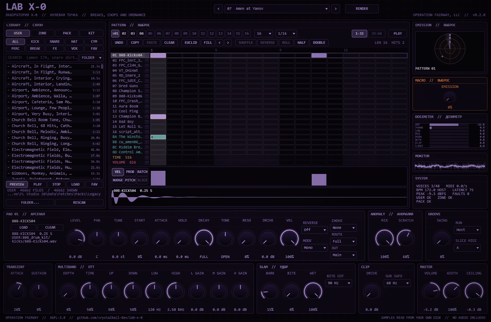

# LAB X-0

A drum machine for breaks, jungle, drum & bass and breakcore, built as a VST® 3 instrument and a standalone app for Windows. It is the fourth LAB X- plugin from OPERATION FAIRWAY, after [LAB X-3](https://github.com/crystalball-dev/lab-x-3), [LAB X-10](https://github.com/crystalball-dev/lab-x-10) and [LAB X-19](https://github.com/crystalball-dev/LAB-X-19).

No laboratory X-0 exists in *S.T.A.L.K.E.R.*. Here it is Project X's unnumbered origin site behind the Chornobyl plant, the zero point every emission starts from. X-3 made hallucinations, X-10 scorched minds, X-19 fused them. X-0 keeps time. Its built-in sounds are real objects of the Zone, read from your own game files: ordnance and gunfire, detector clicks, anomalies, the Monolith's chant and the stalkers' barks.

LAB X-0 is a fan project. It is not affiliated with or endorsed by GSC Game World, and this repository contains no game audio and no samples.



## What it does

- **16 pads and 4 break slots.** Each pad has level, pan, tune, start, attack, hold, decay, a one-knob TONE filter (low-pass one way, high-pass the other) with resonance, drive, velocity, reverse, Poly, Mono or Gate mode, four choke groups and a route: FULL (through ANOMALY and PUNCH), PUNCH, or DRY.
- **Step sequencer for breaks.** 16 patterns of up to 64 steps at 1/8, 1/16, 1/32 or triplets, with a length per lane for polymeters. Every step has velocity, probability, ratchets (up to 4 hits), nudge (half a step either way), pitch and, on break lanes, a slice. Swing, Euclidean fills, random fills, rotate, copy, paste and undo.
- **A mixer track per lane.** Every pad and break has an OUT: the main output, or one of 20 more stereo outputs. In FL Studio, *Auto map outputs* puts each one on a mixer track of its own.
- **Breaks.** Drop a break on a slot and LAB X-0 finds its tempo (ACID chunk, file name, folder, or an estimate in the octave nearest your project) and slices it at its hits or on a 1/8, 1/16 or 1/32 grid. Three FIT modes: REPITCH (speed and pitch follow the project tempo), SLICE (each slice starts on its step at the original speed) and STRETCH (the tempo changes, the pitch does not). A step plays the break where the pattern is, or any slice you give it. SHUFFLE, REVERSE, ROLL, HALF and DOUBLE re-sequence the slices. Files longer than two minutes play from a WINDOW you choose.
- **Slices under your control.** Drag a slice marker on the waveform (it snaps to the nearest hit; hold Shift to place it freely), double-click to add or remove one, zoom with the mouse wheel. Your slices are saved with the project and used everywhere.
- **EXPLODE.** Takes a break apart: alike hits (kicks, snares, ghost notes, rides) each become a pad holding one clean hit, and a new pattern plays the break back on those pads, on time and at its levels. Then mute, move, reroute and reprogram the pieces, or give each its own mixer track.
- **RENDER.** Renders the pattern as heard, the mix and every lane on its own (stems), plus a MIDI file that plays the pattern back in LAB X-0 from FL's piano roll. Drag the files straight from the plugin onto FL Studio's playlist.
- **ANOMALY: chops, repeats, scratches.** Two lanes in every pattern bend the drum bus in time, like Gross Beat. TIME: Springboard repeats (1/4 to 1/64), Whirligig scratches, Vortex reverse, Comet tape stop, Jelly half speed, Burner accelerating roll, Bubble random stutter. VOLUME: electro gates, fades, duck, tremolo and mute. The first pass of every repeat is live, and every jump crossfades.
- **PUNCH.** TRANSIENT (attack and sustain), an OTT-style 3-band MULTIBAND (upward and downward compression, crossovers and band gains), SLAM (BARK tube drive, BITE compression, WET) and CLIP, oversampled, with SUB SAFE keeping everything under its split mono and untouched. Then the LAB X-10 limiter at your ceiling.
- **EMISSION.** One knob, and the mod wheel, that pushes the whole kit harder: transient, multiband, bark, bite, clip, anomaly mix and scratch depth.
- **LIBRARY.** Browse your sample library, the STALKER sounds and the ZONE KIT without leaving the plugin. Categories (KICK, SNARE, HAT, CYM, PERC, BREAK, FX, VOX), search as you type, sort by folder, name, length or tempo, preview, favourites, and drag a sound onto any lane. Files dropped from Explorer load too. A library of 50,000 files lists in under a second and reopens from its cache in milliseconds.
- **ZONE KIT.** 106 hand-picked STALKER hits in six groups: ordnance (pseudogiant steps, body blows, barrel blasts), gunfire, clicks (shell casings, detectors, dry fire), percussion, voices by faction and language, and effects.
- **16 factory kits**, named after places of the Zone, each with its own patterns, matched in loudness.
- **Runaway guard.** Every voice and every effect stage is checked every block. Anything that blows up is silenced and reset instead of reaching your speakers, counted under FAULTS in SYSTEM, and written to `%APPDATA%\OPERATION FAIRWAY, LLC\LAB X-0 faults.log`.

## Playing it in FL Studio

- **Patterns follow FL.** With RUN on Host, LAB X-0 plays its current pattern whenever FL's transport runs, locked to the song position. Stop FL and the breaks stop with it; pads ring out. Loop a bar in the playlist and the pattern loops with it. PLAY switches RUN to Free: the patterns then run on the internal clock at the last tempo FL reported, for the standalone app or with FL stopped.
- **MIDI.** Notes 36 to 51 play the pads (FL calls them C3 to D#4). Notes 52 to 55 start the break slots. Notes 60 to 91 play slices 1 to 32 of the slot chosen in SLICE MIDI, and on MIDI channels 2 to 5 (FL's note colours 2 to 5) the slices of break A to D instead. Notes 96 to 111 switch to patterns 1 to 16 at the end of the current pattern. The mod wheel adds to EMISSION.
- **Programming a break.** Select a break lane, click steps on, and leave them natural (`x`) to play the break as recorded, or open the SLICE strip and give steps other slices. Ratchet a slice for a roll. Put Springboard 1/16 in the TIME lane under the last beat for a stutter, or Vortex for a reverse.
- **Mixing.** Keep the kick and sub on DRY or under SUB SAFE, and push the breaks through PUNCH.
- **A mixer track per lane.** Set OUT on a pad or break to 2 to 21. In FL Studio, open the plugin's wrapper settings (the cog), go to the Processing tab and choose *Auto map outputs*: output 2 lands on the mixer track after LAB X-0's own, output 3 on the next, and so on. A lane on its own output skips ANOMALY, PUNCH and LAB X-0's master section, so give it FL's effects on its track.
- **Taking a break apart.** Select a break lane, press EXPLODE and choose the pads. The break's pieces land on pads, and the next empty pattern plays the break back on them. Edit that pattern freely: delete the ghost notes, double the kick, swap the snare for one from the ZONE KIT.
- **Into the arrangement.** Press RENDER, choose what and how many passes, then drag the files onto the playlist. Stems are as long as the mix, so drop them all at the same bar. Drag the MIDI file into the piano roll of a LAB X-0 channel with the same kit: the pads are in note colour 1 and each break's slices in its own colour (2 to 5), so it plays back as rendered, ready to edit. When a pattern holds something a note can't, the panel says so: a step's pitch, or a natural break step that starts between two slices (set the break's FIT to SLICE for an exact file).

## Sound sources

All audio is read from your own disk at run time; the repository and the plugin contain none.

- **USER** is your sample library. It defaults to FL Studio's legacy packs folder, `E:\Program Files\Image-Line\FL Studio 20\Data\Patches\Packs\Legacy`, or the same folder under FL Studio's install on another drive. FOLDER... picks any other folder, and LAB X-0 remembers it.
- **ZONE** is a STALKER SPECIMENS folder of sounds extracted from your own copies of the games, laid out as `<drive>:\_AUDIO\STALKER SPECIMENS\<game>\sounds\...`. LAB X-0 finds it on drives C: to H:, or you point at it.
- **PACK** is FL Studio's legacy `stalker sounds` pack, found inside the USER folder.
- **KIT** is the curated ZONE KIT, read through ZONE and PACK. `docs/PINNED_PATHS.md` lists its files.

A sample is saved as its library and its path inside it, so a project still opens after you move a library: set the folder again. A missing library says so on the pad.

## Building on Windows

You need Visual Studio 2022 Build Tools with the C++ workload, CMake 3.22 or newer, and a checkout of JUCE 9.

```
cmake -S . -B build -G "Visual Studio 17 2022" -A x64 -DLABX0_JUCE_PATH=C:/path/to/JUCE
cmake --build build --config Release --target LabX0_VST3 LabX0_Standalone LabX0Render
```

`scripts/build.ps1` runs both steps.

## Installing in FL Studio

Copy the plugin file into the standard VST3 folder. `scripts/install.ps1` does this and refuses if FL Studio has the plugin loaded:

```
build/LabX0_artefacts/Release/VST3/LAB X-0.vst3/Contents/x86_64-win/LAB X-0.vst3
  -> C:\Program Files\Common Files\VST3\LAB X-0.vst3
```

Then scan for plugins in FL Studio. LAB X-0 appears under Generators.

## Testing

- `LabX0Render` renders kits and patterns offline to WAV with a simulated host tempo and reports level, faults, latency, triggers and render speed. It also checks presets, the ZONE KIT, tempo and slicing in batches, and the library index.
- `python Tests/make_fixtures.py` writes the synthetic test sounds; `python Tests/run_tests.py` runs the battery: every audio format, broken files and paths, the burst guard, choke and retrigger, step timing at three sample rates, swing, ratchets, nudge and probability, host jumps, MIDI, pattern switches on bar lines at 16 tempos, per-lane outputs, hand-placed slices and regions, EXPLODE on the amen, renders against direct renders, RENDER's MIDI file played back against its render, a 50,000-file index and a 300,000-entry search, categories against 240 hand-labelled names, tempo on 231 tagged loops, slicing against the ReCycle slice points of 151 breaks, the three FIT modes, every anomaly slot against its model, the multiband, slam, clip, SUB SAFE and latency, the transient shaper, every kit, state, a 300-second randomised session, CPU load, pluginval and the runaway guard. Checks that need your libraries report SKIP without them.
- `scripts/validate.ps1` runs [pluginval](https://github.com/Tracktion/pluginval).

`docs/DESIGN.md` describes the design and the results.

## Licence

LAB X-0 is free software under the GNU Affero General Public License v3.0; see `LICENSE`. It is built with [JUCE](https://juce.com) under the AGPLv3 and the Steinberg VST 3 SDK under the MIT licence.

VST is a registered trademark of Steinberg Media Technologies GmbH.
